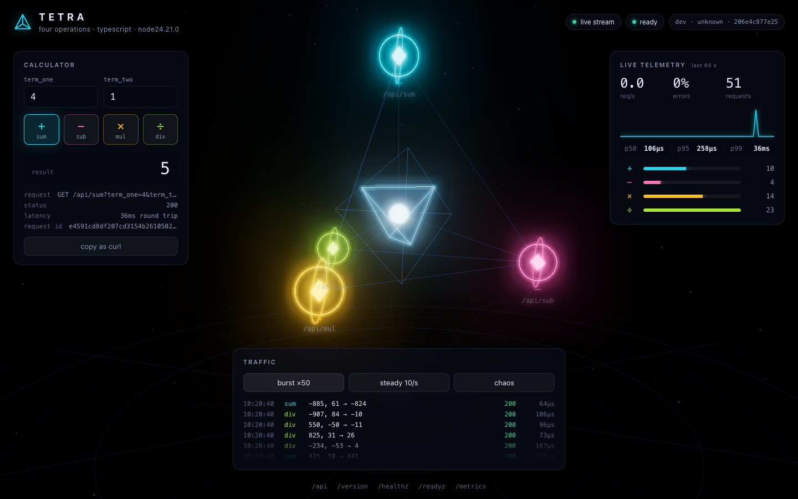

# Tetra · TypeScript

[](https://github.com/giovannirco/tetra-ts/actions/workflows/ci.yml)

A four-operation arithmetic API, built the way I'd ship a production service: tests with coverage, structured logs, Prometheus metrics with SLO alerts, health probes, graceful shutdown, a hardened container, and a three.js UI that draws every request as it happens.

This is the TypeScript implementation: strict TypeScript on Fastify 5, with pino for logs and vitest for tests. It is one of four implementations of the same [contract](docs/CONTRACT.md): [Go](https://github.com/giovannirco/tetra-go), [Ruby](https://github.com/giovannirco/tetra-ruby), [Node.js](https://github.com/giovannirco/tetra-node) and **TypeScript** (this repo). A shared contract test proves the four behave the same.



In the UI each operation sits on a vertex of a tetrahedron around the service core. Every API request, from any client, arrives over Server-Sent Events and becomes a particle: it flies to its operation and into the core, or shatters at the node if it was rejected. The panels show the calculator, the live rate, error ratio and server-side latency percentiles, and a traffic generator with a chaos mode that mixes in invalid requests.

## Quick start

Needs Docker.

```sh
make up        # app, Prometheus and Grafana; open http://localhost:8000
make smoke     # 27-check contract test against the running app
make down
```

| URL | What |
|---|---|
| http://localhost:8000 | UI |
| http://localhost:8000/api/sub?term_one=4&term_two=1 | `{"result":3}` |
| http://localhost:9090/alerts | Prometheus with the SLO alert rules loaded |
| http://localhost:3000 | Grafana, Tetra dashboard as home, no login |

Ports clash with something else? `APP_PORT=8080 GRAFANA_PORT=3300 make up`.

Without Docker, with Node 22+: `npm ci && npm run dev` (tsx, reloads on change).

## API

| Request | Response |
|---|---|
| `GET /api/sum?term_one=4&term_two=1` | `200 {"result":5}` |
| `GET /api/sub?term_one=4&term_two=1` | `200 {"result":3}` |
| `GET /api/mul?term_one=4&term_two=1` | `200 {"result":4}` |
| `GET /api/div?term_one=7&term_two=2` | `200 {"result":3}` |
| `GET /api/div?term_one=1&term_two=0` | `400 {"error":"division by zero"}` |
| `GET /api/sum?term_one=abc&term_two=1` | `400 {"error":"term_one must be an integer, got \"abc\""}` |

Decisions where a spec like this is silent:

- **Integers only, 64-bit, exact.** JavaScript numbers are floats and lose precision above 2^53, so terms and results are `bigint`, range-checked against int64, and the response is written without `JSON.stringify` (which cannot serialize a BigInt). `9223372036854775806 + 1` returns every digit; `1.5` is rejected rather than rounded; a result outside int64 is a `400`.
- **Division truncates toward zero** (`7/2 = 3`, `-7/2 = -3`), which is bigint division.
- **Errors are `400` with a JSON body**, and say what was wrong.

Also served on port 8000: `/healthz` (liveness), `/readyz` (readiness, turns `503` while draining), `/metrics`, `/version`, `/api` (the operation catalogue) and `/events` (the live stream). The full list is in [docs/CONTRACT.md](docs/CONTRACT.md).

## Changing the API

Operations live in one typed list in [`src/calc.ts`](src/calc.ts). Adding one, say modulo, takes two steps:

1. Add an entry:
   ```ts
   { name: 'mod', symbol: '%', label: 'Modulo', apply: (a, b) => { if (b === 0n) throw divisionByZero(); return a % b; } },
   ```
2. Add its cases to `test/calc.test.ts`.

The route `GET /api/mod`, the catalogue at `/api`, the metrics labels and the UI (a new node in the scene, a new button) all pick it up. Then `make up` rebuilds and redeploys the container; the UI header shows the new commit.

## Tests

```sh
make test     # vitest run
make cover    # v8 coverage: text, coverage/index.html, lcov; fails under 90% of lines
```

Coverage is **97.7%** of lines (61 tests); `tsc --noEmit` runs under `strict` and `noUncheckedIndexedAccess`. The tests cover the calculator edge cases (overflow in every operation, `MIN / -1`, truncation), every HTTP status the API returns, readiness during drain, the live stream (fan-out, heartbeat, back-pressure, stream limit, shutdown), metric and log output, path traversal on the static files, and the process lifecycle: start, serve, stop, drain. `scripts/smoke.sh` is the black-box contract test, run in CI against the built container.

## How it is built

```
src/server.ts     entry: config, listen, SIGTERM handling, drain, shutdown
src/calc.ts       the four operations (bigint, int64-checked)
src/api.ts        /api routes, parameter parsing, error mapping, catalogue
src/telemetry.ts  Prometheus metrics and the request log
src/live.ts       Server-Sent Events broker for /events
src/static.ts     the UI, read into memory at startup
src/app.ts        Fastify setup: request IDs, security headers, 404/405, errors
web/              the UI (plain ES modules, three.js vendored, no build step)
observability/    Prometheus config, alert rules, Grafana dashboard
```

- **Fastify, kept on a short leash.** Fastify's own request logging is off and its pino logger is reshaped to the shared `time`/`level`/`msg` keys. The not-found and error handlers return the contract's JSON 404/405/500 bodies, and request IDs come from `genReqId`. The live stream uses `reply.hijack()`, and telemetry listens on the raw response, so hijacked replies are measured too.
- **The API doesn't know about the extras.** `api.ts` reports each calculation through a callback; metrics and the live stream subscribe to it.
- **Observability.** RED metrics per route with a bounded `route` label, calculation outcomes per operation, in-flight requests, build info, plus Node.js runtime and process metrics. One JSON log line per request, carrying the request ID. The alert rules encode two SLOs: 99.9% availability (5xx only) and p99 under 50 ms.
- **Back-pressure.** The live stream checks `writableNeedDrain` before writing, so one slow browser drops its own events and never holds memory or slows a request.
- **Graceful shutdown.** SIGTERM fails readiness, keeps serving for `DRAIN_DELAY_SECONDS` while Kubernetes removes the pod from the Service, ends the live streams, then closes idle and finished connections, cutting the rest after `SHUTDOWN_TIMEOUT_SECONDS`. Fastify's `return503OnClosing` is off: readiness and the drain delay handle the cut-over.
- **Container.** Three stages: compile with the dev toolchain, install production dependencies, ship `dist/` on `node:24-alpine` as the `node` user. Compose runs it read-only with every capability dropped.
- **UI.** three.js is vendored (`make vendor-three`), so the page needs no CDN and the Content-Security-Policy allows only same-origin scripts. Values from the network are written as text, never as HTML.

## Configuration

| Variable | Default | |
|---|---|---|
| `PORT` | `8000` | listen port |
| `LOG_LEVEL` | `info` | `debug` also logs probes and scrapes |
| `DRAIN_DELAY_SECONDS` | `5` | readiness-off period before the listener closes |
| `SHUTDOWN_TIMEOUT_SECONDS` | `10` | limit for in-flight requests on shutdown |
| `MAX_LIVE_STREAMS` | `100` | concurrent `/events` connections |

## What's next

Kubernetes deployment (a Helm chart with an in-cluster-only profile and a public showcase profile), ServiceMonitor and PrometheusRule, OpenTelemetry traces, image signing and scanning, and GitOps delivery. The plan is in [docs/PLAN.md](docs/PLAN.md).

## License

MIT. three.js is MIT, © three.js authors (`web/vendor/three/LICENSE`).
